# EDUVERSE Architecture

## Project baseline

The inspected workspace was empty. There are no existing features, framework,
or database migrations to preserve. The selected stack is Next.js, TypeScript,
and provider-neutral PostgreSQL.

## Proposed application structure

```text
src/
  app/                       Next.js routes and layouts
    (public)/                Registration, login, landing
    (student)/                Student experience
    (teacher)/                Teacher tools
    (admin)/                  Administration
    api/                      Authenticated server endpoints
  components/
    ui/                       Accessible shared controls
    navigation/               Responsive app shell and language/theme controls
    student/                  Dashboard, map, shop, profile, achievements
    quizzes/                  Question, answer, timer, results
    analytics/                Charts and progress summaries
    teacher/                  Classes, assignments, question authoring
    admin/                    User, content, and audit management
  features/                   Domain services and validation schemas
    auth/ economy/ learning/ competitions/ analytics/ content/
  lib/                        Database client, config, logging, shared utilities
  messages/                   English and Tamil interface translations
prisma/
  schema.prisma               Relational model source of truth
  migrations/                 Reviewed PostgreSQL migrations and SQL policies
```

Server components and server actions/API handlers are the trusted boundary for
authorization, scoring, wallet mutations, reward claims, and writes. The browser
may submit choices and actions, but never authoritative scores or balances.
PostgreSQL is the source of truth; UI state is a view of persisted data.

## ER overview

```mermaid
erDiagram
  USER ||--o| STUDENT_PROFILE : has
  USER ||--o| TEACHER_PROFILE : has
  USER ||--o{ USER_ROLE : assigned
  ROLE ||--o{ USER_ROLE : grants
  ROLE ||--o{ ROLE_PERMISSION : contains
  PERMISSION ||--o{ ROLE_PERMISSION : included
  SUBJECT ||--o{ TOPIC : contains
  TOPIC ||--o{ QUESTION : contains
  ADVENTURE_WORLD ||--o{ ADVENTURE_LEVEL : contains
  ADVENTURE_LEVEL ||--o{ STUDENT_LEVEL_PROGRESS : tracks
  STUDENT_PROFILE ||--o{ STUDENT_LEVEL_PROGRESS : unlocks
  QUESTION ||--o{ QUESTION_TRANSLATION : translated
  QUESTION ||--o{ ANSWER_OPTION : offers
  ANSWER_OPTION ||--o{ OPTION_TRANSLATION : translated
  STUDENT_PROFILE ||--o{ QUIZ_SESSION : plays
  QUIZ_SESSION ||--o{ SESSION_QUESTION : includes
  SESSION_QUESTION ||--o| ANSWER_ATTEMPT : answered
  STUDENT_PROFILE ||--o{ STUDENT_PROGRESS : tracks
  TOPIC ||--o{ STUDENT_PROGRESS : measured_for
  STUDENT_PROFILE ||--|| WALLET : owns
  WALLET ||--o{ COIN_TRANSACTION : records
  STUDENT_PROFILE ||--o{ INVENTORY_ITEM : owns
  STORE_ITEM ||--o{ INVENTORY_ITEM : stocked_as
  STUDENT_PROFILE ||--o{ STUDENT_ACHIEVEMENT : earns
  BADGE ||--o{ STUDENT_ACHIEVEMENT : awarded
  STUDENT_PROFILE ||--o{ STUDENT_DAILY_MISSION : progresses
  DAILY_MISSION ||--o{ STUDENT_DAILY_MISSION : assigned
  CLASSROOM ||--o{ CLASS_MEMBERSHIP : includes
  STUDENT_PROFILE ||--o{ CLASS_MEMBERSHIP : joins
  USER ||--o{ TEACHER_ASSIGNMENT : creates
  CLASSROOM ||--o{ TEACHER_ASSIGNMENT : receives
  LEADERBOARD ||--o{ LEADERBOARD_ENTRY : ranks
  STUDENT_PROFILE ||--o{ LEADERBOARD_ENTRY : appears
  STUDENT_PROFILE ||--o{ QUESTION_REPORT : submits
  USER ||--o{ NOTIFICATION : receives
  USER ||--o{ AUDIT_LOG : acts
  COMPETITION ||--o{ COMPETITION_ENTRY : enrolls
  STUDENT_PROFILE ||--o{ COMPETITION_ENTRY : competes
  QUIZ_ROOM ||--o{ QUIZ_ROOM_MEMBER : hosts
  STUDENT_PROFILE ||--o{ QUIZ_ROOM_MEMBER : joins
```



## Relationship and integrity rules

- A user has at most one student profile and at most one teacher profile.
  Authorization is granted independently through role/permission joins.
- Subjects own topics; topics own questions. A question has one translation per
  supported locale. Answer options also have per-locale text so the entire quiz
  (including choices, hints, and explanations) can be localized.
- A quiz session belongs to one student and contains ordered question records.
  Each included question can have at most one final attempt in that session.
  Attempts and correct answers are computed and persisted server-side.
- Student progress is unique per student and topic. XP, levels, and analytics
  are derived from persisted outcomes, not trusted client values.
- Adventure worlds contain ordered levels; per-student level records persist
  unlocks, attempts, completion, and best score. Unlock eligibility is checked
  server-side against prior completion and configured XP/level requirements.
- A student profile owns exactly one wallet. Transactions are append-only,
  positive-amount ledger entries with an idempotency key and resulting balance.
  Wallet balance is nonnegative; all mutations lock/update the wallet and write
  the ledger entry in one database transaction.
- Inventory is ownership of catalog items; purchases atomically debit the
  wallet and create the inventory row. Achievement and daily-mission claims
  have unique student/award keys to prevent duplicate rewards.
- Classroom memberships and teacher assignments are explicit relationships;
  classroom visibility is limited to assigned teachers and members.
- Leaderboards store period/scope snapshots. Scores are computed from trusted
  sessions; global and classroom scopes use distinct scope keys.
- Competition entries, room membership, reports, notifications, and audit rows
  all reference their owning records. Audit history is not client-editable.

## Database and security decisions

- PostgreSQL with Prisma for typed access and reviewed, versioned migrations.
- Add PostgreSQL `CHECK` constraints in migrations for positive coin amounts,
  nonnegative balances/progress, and valid time ranges. Prisma schema alone
  cannot express all of these invariants.
- Use Argon2id password hashes and opaque, hashed, expiring session tokens.
  Never store plaintext passwords or session tokens.
- Centralize policy checks in server-side domain services. Roles grant coarse
  permissions; resource ownership/classroom membership checks provide
  row-level authorization. PostgreSQL RLS policies should be added for
  sensitive student-scoped tables when the connection strategy can safely set
  per-request identity. RLS is defense in depth, not a replacement for service
  authorization.
- Validate all request payloads at the boundary, rate-limit authentication,
  quiz submissions, room joins, and report creation, and keep secrets in
  environment variables. Do not send private student data to AI providers
  without an explicit privacy/retention policy.
- Configure automated encrypted backups and periodically test point-in-time
  recovery before production. Keep migrations separate from backups.
- No production seed/demo users, leaderboard entries, or simulated database
  operations are part of this design.

## UI component structure

- `AppShell`: responsive navigation, page frame, language picker, theme toggle.
- `StudentDashboard`: persisted streak/progress summary, missions, continue
  learning, and recent activity.
- `AdventureMap` / `LevelNode`: subject worlds, locked/unlocked state, progress,
  and reduced-motion-aware progression effects.
- `QuizPlayer`: localized prompt/options, accessible timer, answer feedback,
  explanation, and server-confirmed result.
- `WalletPanel` / `Marketplace` / `Inventory`: real balance, ledger history,
  catalog, purchase state, and equipped cosmetics.
- `ProfileHeader` / `AchievementGallery` / `Leaderboard`: persisted profile,
  earned badges, and scoped/time-bounded rankings.
- `AnalyticsDashboard`: server-aggregated accuracy, attempts, topic mastery,
  and trends, with loading, empty, and error states.
- `TeacherDashboard`: authorized classes, assignments, question authoring and
  import, competition setup, and student analytics.
- `AdminConsole`: role-controlled content/user management and audit review.
- Shared accessible primitives: buttons, dialogs, forms, cards, progress,
  skeletons, error boundaries, and localized empty states.

Tamil and English are supported through a locale dictionary for interface
copy and locale-keyed database translations for authored learning content.
Persist the preference on the user profile and use it for server rendering.
Theme preference can be stored in a cookie/local preference; it is not an
authorization or learning record.

## Implementation roadmap

1. **Foundation and schema** — initialize the app, database client, migrations,
   authentication/session baseline, validation, logging, and CI checks.
2. **Learning loop** — role-gated student accounts, localized content, quiz
   sessions, server-validated answers, progress persistence, and explanations.
3. **Progression and economy** — XP/levels, missions, badges, wallet ledger,
   idempotent rewards, marketplace, inventory, and clue purchases.
4. **Classrooms and competition** — teacher assignments, classroom/global
   leaderboard snapshots, competitions, and multiplayer room lifecycle.
5. **Teacher/admin and analytics** — content management/import, reporting,
   analytics, moderation, notifications, and auditable admin operations.
6. **AI, polish, and production readiness** — privacy-reviewed AI assistance
   and generation, adaptive recommendations, responsive visual system,
   accessibility/reduced motion, performance, backup/restore drills, and
   security/load testing.

Each stage should add focused database/service tests and interaction tests
before the next stage. Deployment-specific provider configuration and any AI
provider/retention policy remain open until deployment is selected.

## Stage 1 implementation status

The initial app scaffold, responsive landing/auth screens, registration,
login/logout/session endpoints, password hashing, input validation, and
PostgreSQL-backed authentication throttling are implemented. The schema also
includes the hashed rate-limit buckets used by those endpoints. See
`getting-started.md` for local setup.

Stage 1 is not yet verified end-to-end: dependencies have not been installed,
Prisma Client has not been generated, and no database migration has been
applied. Run the documented bootstrap against a local PostgreSQL database,
then verify the auth flows and generated migration before advancing to the
learning loop.
